# TREBALL DE RECERCA: COTXE AUTÒNOM

**FET PER:** Sergi Rodríguez Garcia, Joan Pla Capdevila, Enric Simó Benítez i Marcel Gonfaus Sant

**INSTITUT ESCOLA INDUSTRIAL**

**CURS:** 2n de Batxillerat, 2025-26

**TUTOR:** JOSEP MARIA BERGADÀ FABREGAT

---

## INDEX

- 1\. ABSTRACT
- 2\. INTRODUCCIÓ
  - 2.1. La idea
  - 2.2. Sobre el projecte
  - 2.3. Organització

**BLOC I: RECERCA**

- 3\. MARC TEÒRIC
  - 3.1. Història dels cotxes autònoms
  - 3.2. Què és un cotxe autònom?
  - 3.3. Com funciona un cotxe autònom?
  - 3.4. Graus d’autonomia

**BLOC II: ELECTRÒNICA**

- 4\. SENSORS
  - 4.1. LiDAR LD500
  - 4.2. Sense HAT 1.0.0
  - 4.3. Sensors de proximitat HC-SR04 Pro
- 5\. ACTUADORS
  - 5.1. Motor GA12-N20 Encoder DC
  - 5.2. Servomotor MG90S
- 6\. CONTROLADORS
  - 6.1. Raspberry Pi 4
  - 6.2. Driver DRV8833
- 7\. ALIMENTACIÓ
  - 7.1. Bateries OVONIC LiPo
  - 7.2. Hobbywing BEC
- 8\. ESQUEMA DE CONNEXIONS

**BLOC III: MECÀNICA**

- 9\. DESENVOLUPAMENT DEL DISSENY
  - 9.1. El disseny
    - 9.1.1. Inspiració del disseny del cotxe
    - 9.1.2. Programes de disseny 3D
    - 9.1.3. Com ha anat avançant?
    - 9.1.4. Imprevistos i millores en els prototips
  - 9.2. El resultat final
- 10\. MECANISMES
  - 10.1. Geometria d’Ackermann
  - 10.2. Aplicació de l’arquitectura d’Ackermann
  - 10.3. Transmissió del diferencial
  - 10.4. Aplicació del diferencial
- 11\. IMPRESSORES 3D
  - 11.1. Com funcionen?
  - 11.2. Quina impressora 3D hem utilitzat?
    - 11.2.1. Bambu Lab P1S
    - 11.2.2. Bambu Lab H2D
  - 11.3. Paràmetres d’impressió
- 12\. MATERIALS UTILITZATS
  - 12.1. Quins materials teníem disponibles?
  - 12.2. Materials per a cada peça

**BLOC IV: PROGRAMACIÓ**

- 13\. EXPLICACIÓ DE ROS 2
  - 13.1. Estructura d’un node
- 14\. PLANIFICACIÓ DEL CODI
- 15\. LOCALITZACIÓ
  - 15.1. Bicycle Model
- 16\. MAPATGE
  - 16.1. lidar_image_creator
  - 16.2. lidar_processing
  - 16.3. Integració de la localització
- 17\. PLANIFICACIÓ DE LA TRAJECTÒRIA
  - 17.1. Separació dels cons
  - 17.2. Generació de la trajectòria
  - 17.3. Bridge
- 18\. CONTROL
  - 18.1. Control de velocitat
  - 18.2. Control de la direcció
    - 18.2.1. Seguiment de la trajectòria
    - 18.2.2. Sistema de seguretat
  - 18.3. Comunicació amb el servomotor
- 19\. ORGANITZACIÓ GLOBAL
  - 19.1. Llegenda
  - 19.2. Explicació
- 20\. SIMULACIÓ I LAUNCHERS
  - 20.1. Simulació
  - 20.2. Launchers
- 21\. VERSIONS

**BLOC V: CONCLUSIONS**

- 22\. INCIDÈNCIES
- 23\. RESULTATS
- 24\. CONCLUSIONS
- 25\. AGRAÏMENTS

- ANNEXOS
  - Annex 1: Codi exemple d’un node de ROS 2
  - Annex 2: Mapa conceptual del sistema
  - Annex 3: Esquema de connexions del cotxe
- ÍNDEX D’IMATGES
- ÍNDEX DE TAULES
- BIBLIOGRAFIA

---

## 1. ABSTRACT

### Castellà

El objetivo principal de este Trabajo de Investigación ha sido crear, a partir de los conocimientos de Bachillerato, un pequeño coche autónomo capaz de recorrer un circuito. Para llevar a cabo este proyecto se han usado conocimientos de programación, mecánica, electrónica, robótica e inteligencia artificial.

En la primera parte del trabajo se ha realizado una investigación sobre los coches autónomos y su evolución, con el objetivo de comprender su funcionamiento y adquirir los conocimientos necesarios para diseñar y construir nuestro propio coche autónomo. Posteriormente se han estudiado los recursos que se requieren para este trabajo, los componentes del coche y su chasis. Todo esto para poder desarrollar los programas para el vehículo.

Una vez finalizado el montaje, se han realizado diversas pruebas para comprobar que el coche funcione correctamente y corregir los errores cometidos en la parte de programación y de robótica.

En conclusión, este Trabajo de Investigación demuestra que, con los conocimientos adquiridos durante el Bachillerato, dedicación y mucho compromiso es posible crear un pequeño coche autónomo. Además, esta investigación ha permitido ampliar los conocimientos sobre programación, mecánica, robótica y poder comprender mejor el funcionamiento y las complejidades de los coches autónomos.

### Anglès

The main objective of this Research Project was to build a small autonomous car with the knowledge acquired during high school. The car was designed to go through a circuit without human assistance. To do this project, knowledge of programming, mechanics, electronics and artificial intelligence was used.

The first part of the work focused on researching autonomous cars and their evolution. The aim was to understand how they work and to acquire the knowledge needed to design and build our own autonomous car. Afterwards, the resources needed for the project, as well as the components of the car and the chassis were studied. All of this was done in order to develop the software for the car.

Once the building part was finished, several tests were carried out to make sure that the vehicle worked properly and to correct the errors that were found during testing.

To sum up, this Research Project demonstrates that, with the knowledge acquired during high school, a lot of dedication and perseverance it is possible to create a small autonomous car. Moreover, this investigation allowed us to expand our knowledge of programming, mechanics and robotics, while providing a better understanding of how autonomous vehicles work and their complexities.

## 2. INTRODUCCIÓ

### 2.1. La idea

La idea de fer un projecte tan elaborat com el d’un cotxe autònom va sorgir d’una pluja d’idees en què volíem combinar diversos aspectes que agradessin a tots els membres del grup, com ara la programació, la mecànica o l’electrònica.

Al principi es va proposar fer un avió de control remot, però vam veure que s’havien d’aplicar molts conceptes nous que desconeixíem i vam decidir no fer-lo.

Quan es van presentar els treballs de recerca de 2n de batxillerat, n’hi va haver un que ens va cridar l’atenció a tots: un kart que es podia conduir. Va ser llavors quan ens va venir la idea de fer un cotxe que no estigués conduït per un humà sinó per un ordinador. Així que es va acordar que faríem un cotxe autònom fet per nosaltres des de zero.

### 2.2. Sobre el projecte

L’objectiu principal d’aquest treball és dissenyar i construir un cotxe autònom a escala capaç de recórrer un circuit delimitat per cons sense cap intervenció humana. La hipòtesi de partida és que, amb components de baix cost i els coneixements adquirits durant el batxillerat, és possible construir un vehicle que apliqui a petita escala els mateixos principis que fan servir els cotxes autònoms reals.

Els cotxes autònoms representen una de les tecnologies amb més potencial dins del sector de l’automoció. En els últims anys, empreses com Waymo, Tesla o Zoox han investigat i desenvolupat nombrosos prototips, fet que ha contribuït a l’evolució dels cotxes autònoms i ha despertat un gran interès per aquesta tecnologia. És un tema molt important, ja que podria reduir considerablement els accidents de trànsit produïts pels humans i millorar la conducció.

Aquest és un dels principals motius per a l’elecció d’aquest tema. A més, en els cotxes autònoms són essencials tots els àmbits que volíem combinar. I, com que som molt aficionats al món del motor i l’automobilisme, hem volgut que el disseny i la impressió 3D del cotxe fossin una part important del projecte. D’altra banda, vam pensar com es podria crear un cotxe autònom i quines dificultats ens causaria fer-lo.

### 2.3. Organització

Hem dividit el treball en quatre blocs principals, que corresponen a les diferents àrees que intervenen en un cotxe autònom:

- **Recerca:** estudia què és un cotxe autònom, com ha evolucionat aquesta tecnologia i en quin punt es troba actualment. També analitza el que han fet diferents empreses del sector i fins a quin punt és viable aplicar aquesta tecnologia en el futur.
- **Electrònica:** analitza quins sensors existeixen, quins ens poden ser útils per al projecte i com s’han de connectar i alimentar perquè tot funcioni correctament.
- **Mecànica:** explica com funciona la mecànica d’un cotxe, especialment el sistema de direcció i la transmissió, i com hem dissenyat i fabricat les peces del nostre vehicle.
- **Programació:** explica com es programa un cotxe autònom i com hem utilitzat les dades dels diferents sensors perquè el vehicle es pugui localitzar, crear un mapa del circuit i seguir-lo.

Per assolir l’objectiu principal del treball, vam escollir les eines de cada bloc: Fusion 360 per al disseny 3D de les peces del cotxe, Inkscape per dissenyar el circuit, i ROS 2 i Python per a la programació.

Per dur a terme el treball, hem utilitzat una metodologia basada en la distribució de tasques segons les habilitats i els coneixements especialitzats de cada membre del grup. Els rols s’han assignat de la manera següent:

- **Programació:** Enric
- **Mecànica:** Sergi
- **Electrònica i sensors:** Joan
- **Recerca de l’automobilisme autònom:** Marcel

Aquesta organització ens ha permès treballar durant l’estiu sense necessitat de fer reunions presencials constants, ja que cada membre ha pogut avançar en la seva àrea de manera independent.

Malauradament, cada integrant del grup ha tingut una manera diferent de treballar, i això es veu reflectit en el document: segons el bloc que es llegeixi, els continguts s’han explicat de maneres diferents.

Finalment, ens hem reunit per integrar les diferents parts del projecte, comprovar-ne la compatibilitat i posar en pràctica el sistema complet. Aquesta fase ha estat fonamental per coordinar la feina individual i aconseguir que tots els components funcionessin conjuntament.

# BLOC I: RECERCA

## 3. MARC TEÒRIC

### 3.1. Història dels cotxes autònoms

Tot va començar l’any 1925, quan l’empresa nord-americana Houdina Radio Control va crear un cotxe sense ningú al volant. No es tractava d’un vehicle autònom, ja que estava controlat a través d’un sistema de radiocontrol, que funciona amb una persona que envia ordres de moviment i direcció a través d’un comandament.

Aquest projecte va inspirar moltes persones a imaginar noves possibilitats per al futur de l’automoció. Una d’aquestes persones va ser el dissenyador Norman Bel Geddes, qui l’any 1939 va presentar Futurama, una exposició on mostrava una possible ciutat del futur. En aquesta ciutat hi hauria milers de cotxes propulsats per camps electromagnètics i controlats automàticament. Tot això, amb l’objectiu de reduir els accidents a les carreteres.

Durant els anys següents, els avenços en informàtica, sensors i intel·ligència artificial van permetre desenvolupar sistemes autònoms cada cop més avançats. Durant les dècades dels vuitanta i noranta, Ernst Dickmanns, un professor i investigador alemany, va tenir un paper destacat en el desenvolupament d’aquestes tecnologies.

L’any 1987, Dickmanns va presentar el projecte VaMoRs. Es tractava de transformar una furgoneta Mercedes-Benz 508D en un vehicle autònom amb càmeres, sensors i un sistema informàtic molt avançat. Aquest prototip va arribar a velocitats de 90 km/h en autopistes alemanyes.

Anys més tard, el 1994, Dickmanns va crear el projecte VaMP, en el qual va modificar un cotxe Mercedes 500 SEL amb les tecnologies desenvolupades pel seu equip. El vehicle va dur a terme proves de llarga distància i va arribar a velocitats de 130 km/h pels afores de París. Gràcies a aquests avenços, la Comissió Europea va invertir en el projecte EUREKA Prometheus, un dels més importants sobre la conducció autònoma de l’època.

L’any 1995, Dickmanns va aconseguir unir Múnic amb Odense, Dinamarca, amb un Mercedes Classe S modificat. En total, el vehicle va recórrer més de 1.750 quilòmetres esquivant i avançant cotxes, tot de manera autònoma.

<a id="imatge-1"></a>

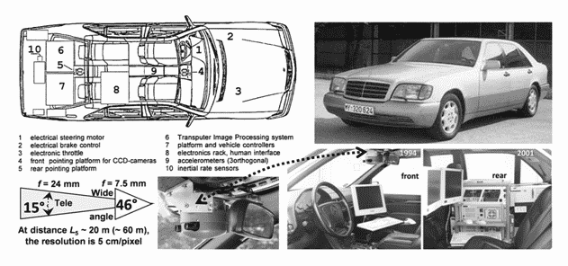

*Imatge 1: Projecte VaMP d’Ernst Dickmanns (Mercedes 500 SEL)*

L’any 2004, DARPA, una agència nord-americana, va impulsar el desenvolupament dels vehicles autònoms amb la creació del DARPA Grand Challenge, una competició destinada a posar a prova diferents sistemes de navegació autònoma.

El 2009, Google va iniciar el seu projecte de vehicles autònoms, liderat inicialment per l’enginyer Sebastian Thrun, que havia participat anteriorment al DARPA Grand Challenge. En el projecte es van fer diverses proves amb vehicles equipats amb sensors, càmeres i sistemes informàtics capaços de detectar l’entorn i prendre decisions.

L’any 2015 Google va presentar Firefly, un prototip dissenyat per estudiar la conducció sense els controls convencionals d’un automòbil. Estava equipat amb diferents sensors i sistemes informàtics i anava sense volant ni pedals. Posteriorment, el projecte de Google es va convertir en Waymo, una empresa de tecnologia de conducció autònoma independent.

Waymo va continuar fent proves i desenvolupant els seus prototips, fins que l’any 2018 va llançar el seu servei de transport autònom en algunes zones determinades. Més endavant, el servei es va anar ampliant a més zones.

En conclusió, el desenvolupament dels cotxes autònoms ha estat progressiu i continuarà evolucionant a mesura que s’investiguin i desenvolupin noves tecnologies, amb l’objectiu de fer-los cada vegada més eficients i segurs.

### 3.2. Què és un cotxe autònom?

Els vehicles totalment automatitzats, també coneguts com a cotxes autònoms, són capaços de circular sense intervenció humana de manera continuada durant un període de temps. Per aconseguir-ho, utilitzen diverses tecnologies com sensors de percepció de l’entorn, càmeres, ordinadors i programes informàtics que els permeten prendre decisions. Són capaços de percebre l’exterior, interpretar-lo i prendre decisions en temps real per circular de manera segura.

### 3.3. Com funciona un cotxe autònom?

Per funcionar, els cotxes autònoms estan equipats amb diferents tecnologies que treballen conjuntament:

- **Sensors de percepció de l’entorn:** a través de càmeres, radars, LiDAR i ultrasons, detecten possibles obstacles com ara vianants, cotxes i senyals de trànsit.
- **Sistemes de posicionament:** el GPS permet determinar la ubicació del vehicle.
- **Sistemes de comunicacions:** permeten intercanviar la informació necessària per a garantir una conducció automatitzada segura. Un exemple és la tecnologia V2X (*Vehicle-to-everything*), que permet intercanviar informació amb altres vehicles, amb la infraestructura viària o amb altres elements de l’entorn.
- **Sistemes avançats de control:** gestionen les tasques del vehicle. Per exemple, per evitar que el cotxe perdi l’estabilitat s’utilitza el sistema de control electrònic d’estabilitat (ESC).
- **Sistemes d’aprenentatge automàtic:** també coneguts com a *machine learning*, permeten aprendre de proves anteriors i prendre decisions per si mateixos sense ser programats amb instruccions fixes.
- **Algoritmes complexos:** formen part del programari que processa la informació recollida pels sensors. Per desenvolupar aquest programari es poden utilitzar diversos llenguatges com Python, C o C++, entre altres.
- **Controladors i actuadors:** reben instruccions del programari i controlen accions com la frenada, la direcció i l’acceleració.
- **Unitats de control i processadors:** executen el programari i transformen les dades dels sensors en ordres per al volant, l’accelerador i el fre.

En conjunt, aquestes tecnologies col·laboren per controlar el moviment del vehicle i realitzar les maniobres necessàries.

### 3.4. Graus d’autonomia

Segons la Societat d’Enginyers d’Automoció (SAE), hi ha sis nivells d’automatització, classificats segons el grau d’atenció i d’intervenció humana que es necessita durant la conducció, així com segons el desenvolupament i l’ús de les tecnologies utilitzades en el vehicle. Els sis nivells van del nivell 0 (manual) al nivell 5 (totalment automatitzat):

**GRAU 0 - MANUAL**

Conducció manual. El conductor s’encarrega de totes les tasques de conducció sense rebre l’ajuda de cap sistema complex.

**GRAU 1 - FEET OFF**

Conducció assistida. Un sistema d’assistència s’encarrega de controlar la direcció o l’acceleració, però no les dues alhora.

**GRAU 2 - HANDS OFF**

Automatització parcial. Un o diversos sistemes d’assistència controlen la direcció i l’acceleració.

**GRAU 3 - EYES OFF**

Automatització condicionada. Un sistema de conducció automatitzada realitza totes les tasques amb limitacions. El conductor ha d’estar pendent.

**GRAU 4 - MIND OFF**

Automatització alta. Un sistema de conducció automatitzada realitza totes les tasques de conducció.

**GRAU 5 - DRIVERLESS**

Automatització completa. Un sistema de conducció automatitzada realitza totes les tasques de conducció en qualsevol condició. No cal que el vehicle estigui equipat amb volant ni pedals.

# BLOC II: ELECTRÒNICA

## 4. SENSORS

### 4.1. LiDAR LD500

El LiDAR LD500 serveix per saber a quina distància estan els objectes que hi ha al voltant del cotxe. Envia un làser i calcula el temps que triga a tornar després de rebotar contra un objecte.

En un cotxe autònom, s’utilitza principalment per detectar obstacles i evitar col·lisions. També ajuda el cotxe a saber com és l’espai que té al seu voltant.

Les característiques tècniques completes es poden consultar a la fitxa tècnica del component: <https://files.waveshare.com/wiki/D500-LiDAR-Kit/LDROBOT_STL-19P_Datasheet_EN_v1.0(1).pdf>

### 4.2. Sense HAT 1.0.0

El Sense HAT 1.0.0 és una placa que es pot connectar a una Raspberry Pi i que té diferents sensors. En un cotxe autònom pot servir per obtenir informació sobre el moviment i les condicions de l’entorn.

Té sensors per mesurar la temperatura, la pressió i la humitat, i també té una IMU, que és un sensor que detecta el moviment, la inclinació i la direcció del cotxe. De tots aquests sensors, en aquest projecte només s’utilitza la IMU; els de temperatura, pressió i humitat no es fan servir.

Les característiques tècniques completes es poden consultar a la fitxa tècnica del component: <https://pip-assets.raspberrypi.com/categories/676-raspberry-pi-sense-hat/documents/RP-008384-DS-1-sense-hat-product-brief.pdf>

### 4.3. Sensors de proximitat HC-SR04 Pro

L’HC-SR04 Pro és un sensor de distància per ultrasons. Emet un pols d’ultrasons i mesura el temps que triga a tornar l’eco després de rebotar contra un objecte. A partir d’aquest temps, i coneixent la velocitat del so, es pot calcular a quina distància es troba l’obstacle.

En el nostre cotxe n’hi ha dos, i s’utilitzen en el sistema de seguretat del control de la direcció per detectar parets o obstacles propers si la resta del sistema falla.

Les característiques tècniques completes es poden consultar a la fitxa tècnica del component: <https://sigmanortec.ro/en/ultrasonic-sensor-hc-sr-04p-3-55v>

## 5. ACTUADORS

### 5.1. Motor GA12-N20 Encoder DC

El GA12-N20 Encoder DC és un motor petit que serveix per fer girar les rodes del cotxe. Està format per un motor de corrent continu i un *encoder*.

L’*encoder* permet saber com està girant el motor, per exemple la seva velocitat i quantes voltes ha fet. Això és útil en un cotxe autònom perquè permet controlar millor el moviment i fer que el cotxe avanci a la velocitat desitjada.

Les característiques tècniques completes es poden consultar a la fitxa tècnica del component: <https://es.scribd.com/document/388716290/GA12-N20>

### 5.2. Servomotor MG90S

El servomotor MG90S és un petit motor que es controla mitjançant impulsos elèctrics: la durada de cada impuls indica la posició a la qual ha de girar, cosa que permet controlar amb precisió quants graus gira.

En el nostre cotxe, s’ha utilitzat per controlar la direcció de les rodes.

Les característiques tècniques completes es poden consultar a la fitxa tècnica del component: <https://towerpro.com.tw/product/mg90s-3/>

## 6. CONTROLADORS

### 6.1. Raspberry Pi 4

La Raspberry Pi 4 és el component principal que controla el cotxe. Rep la informació dels sensors, la processa i decideix què ha de fer el cotxe.

Per exemple, pot rebre informació del LiDAR i detectar que hi ha un obstacle. En aquest cas, pot enviar una ordre als motors perquè el cotxe freni o canviï de direcció.

Les característiques tècniques completes es poden consultar a la fitxa tècnica del component: <https://pip-assets.raspberrypi.com/categories/545-raspberry-pi-4-model-b/documents/RP-008341-DS-1-raspberry-pi-4-datasheet.pdf>

### 6.2. Driver DRV8833

El DRV8833 és un controlador (doble pont H) que serveix per controlar els motors. La Raspberry Pi envia les ordres al *driver* i aquest controla la velocitat i el sentit de gir dels motors. No té pin de PWM separat: la velocitat es controla aplicant el PWM directament a les entrades xIN1/xIN2.

<a id="taula-1"></a>

*Taula 1: Connexions del DRV8833 i de l’encoder*

| Senyal | GPIO (BCM) |
|---|---|
| AIN1 (motor A, amb encoder) | 5 |
| AIN2 (motor A) | 6 |
| BIN1 (motor B, sense encoder) | 26 |
| BIN2 (motor B) | 16 |
| Encoder fase A | 27 |
| Encoder fase B | 17 |

El pin STBY (nSLEEP) del DRV8833 està connectat a VM, de manera que el *driver* està sempre habilitat i no ocupa cap GPIO.

Això permet que el cotxe pugui avançar i anar enrere.

Les característiques tècniques completes es poden consultar a la fitxa tècnica del component: <https://www.ti.com/lit/ds/symlink/drv8833.pdf>

## 7. ALIMENTACIÓ

En aquest apartat es descriuen els components que proporcionen i regulen l’energia de tot el cotxe.

### 7.1. Bateries OVONIC LiPo

Les bateries OVONIC LiPo són les que proporcionen l’energia necessària perquè funcioni el cotxe. Alimenten els motors, la Raspberry Pi i la resta de components.

Les bateries LiPo tenen una bona relació entre pes i capacitat, per això són molt utilitzades en vehicles petits, drons i projectes de robòtica.

Tot i això, són perilloses i s’han de manipular amb molta precaució, ja que un curtcircuit pot fer que la bateria s’escalfi molt ràpidament i acabi explotant.

Les característiques tècniques completes es poden consultar a la fitxa tècnica del component: <https://www.ovonicshop.com/>

### 7.2. Hobbywing BEC

El Hobbywing BEC serveix per regular el voltatge que arriba als diferents components. La bateria dona una tensió que pot ser massa alta per a alguns components, i el BEC l’adapta perquè puguin funcionar correctament.

Així ajuda a protegir la Raspberry Pi i els altres components del cotxe.

Les característiques tècniques completes es poden consultar a la fitxa tècnica del component: <https://www.hobbywing.com/en/products/ubec-5a93>

## 8. ESQUEMA DE CONNEXIONS

Perquè tant els sensors com els controladors i els actuadors puguin funcionar, han d’estar tots ben connectats i ben alimentats. Per això el mapa de connexions és important. L’esquema complet es troba a l’[Annex 3](#annex-3).

Com es pot veure a l’esquema, la bateria va connectada directament al regulador (BEC), que en redueix la tensió a 5 V. Del regulador surten tres cables de 5 V i tres de GND. Una parella va a la Raspberry (pins 4 i 6), una altra al servomotor i l’última al *driver* dels motors (DRV8833). Tant el Sense HAT com el LiDAR s’alimenten de la Raspberry, ja que no demanen gaire corrent.

El LiDAR està connectat a un adaptador USB-UART que permet connectar-lo a la Raspberry per USB. El Sense HAT, en canvi, va muntat directament a sobre del connector de 40 pins de la Raspberry.

Els motors es connecten a les sortides del *driver*: el motor B a BOUT1 i BOUT2, i el motor A a AOUT1 i AOUT2. A més, el motor A té un *encoder* per mesurar la velocitat de gir. L’*encoder* envia els seus dos senyals als GPIO 27 (fase A, pin 13) i 17 (fase B, pin 11), s’alimenta amb els 3,3 V del pin 1 i té el GND connectat al pin 25. Finalment, la Raspberry controla el *driver* a través de les entrades AIN1, AIN2, BIN1 i BIN2 (vegeu la Taula 1).

El servomotor, a part de l’alimentació, només té un cable, pel qual rep el senyal. Aquest cable està connectat al GPIO 4 (pin 7).

Els dos sensors de proximitat s’alimenten amb els 3,3 V del pin 17 i tenen el GND connectat al pin 39. Cada sensor utilitza dos GPIO: un per al Trig, que envia el pols d’ultrasons, i un altre per a l’Echo, que retorna el temps que triga l’eco. El primer sensor té el Trig al GPIO 13 (pin 33) i l’Echo al GPIO 19 (pin 35), i el segon té el Trig al GPIO 20 (pin 38) i l’Echo al GPIO 21 (pin 40).

# BLOC III: MECÀNICA

## 9. DESENVOLUPAMENT DEL DISSENY

### 9.1. El disseny

#### *9.1.1. Inspiració del disseny del cotxe*

El disseny del cotxe es va basar en diversos xassís de cotxes vistos des de dalt per saber la forma i l’estructura que tenen. Més endavant, mentre es dissenyava en CAD, el disseny dibuixat originalment es va anar modificant fins a obtenir-ne una versió millorada i amb aspectes més innovadors.

#### *9.1.2. Programes de disseny 3D*

Avui en dia, hi ha molts programes de disseny i modelatge 3D, com ara FreeCAD, Tinkercad, Blender o Fusion 360. Alguns ja els havíem fet servir en cursos anteriors, però per fer aquest treball calien moltes funcions especials, així que hem optat per Fusion 360.

Fusion 360 és un programa de modelatge i disseny 3D amb llicència de pagament o pla gratuït, que fan servir empreses molt conegudes com Airbus o SpaceX per als seus prototips.

Hem triat aquest programa principalment per la practicitat i la varietat d’opcions que ens dona a l’hora de modelar i pel que fa a importar i exportar models 3D.

Aquí hi ha una taula comparativa dels programes:

<a id="taula-2"></a>

*Taula 2: Comparativa dels programes de disseny 3D*

| Programa | Avantatges | Inconvenients |
|---|---|---|
| Tinkercad | Fàcil | Massa limitat |
| FreeCAD | Gratuït i de codi obert | Interfície poc intuïtiva |
| Blender | Molt potent | Poc orientat a enginyeria |
| Fusion 360 | Paramètric i tècnic | Corba d’aprenentatge alta |

#### *9.1.3. Com ha anat avançant?*

Quan vam començar a fer l’esbós inicial, no vam preveure alguns errors, com el mecanisme de gir i l’espai que necessitaria, la posició del diferencial o com aniria connectat el motor, entre altres problemes d’ubicació i d’estètica.

#### *9.1.4. Imprevistos i millores en els prototips*

Mentre s’anava dissenyant, vam començar a fer prototips sencers del que seria el resultat final amb les impressores proporcionades per l’escola, però, com en tot projecte elaborat, es van detectar diversos aspectes de millora.

##### *Prototip #1*

En el primer prototip el vehicle estava separat en dues parts. Aquesta configuració feia que l’estructura fos més propensa a enfonsar-se o deformar-se si havia de suportar massa pes a la part superior.

També es va provar de fabricar una reductora d’engranatges pròpia. Tot i això, el disseny dels engranatges no era correcte i aquests lliscaven entre ells, de manera que no transmetien el moviment correctament.

A partir d’aquests problemes es van decidir diverses modificacions.

En primer lloc, es va passar a fabricar el xassís en una sola peça, amb l’objectiu d’aconseguir una estructura més resistent. També es van reforçar algunes parts que podien acabar trencant-se amb l’ús.

Per al sistema de transmissió es va abandonar la reductora d’engranatges que s’havia dissenyat inicialment i es va passar a utilitzar un motor reductor.

##### *Prototip #2*

En el segon prototip es van continuar fent modificacions a partir dels problemes i limitacions detectats anteriorment.

Es va decidir canviar el motor reductor usat anteriorment pel motor que es fa servir actualment, un motor GA12-N20 amb *encoder* de 6 V.

També es va modificar la geometria del vehicle per millorar el sistema de gir i es va augmentar una mica la batalla del vehicle. A més, es va augmentar l’amplada de les rodes.

Un altre canvi important va ser la creació d’una nova peça en forma de L, dissenyada per connectar el servomotor amb la barra metàl·lica del sistema de direcció.

Aquestes modificacions es van fer amb l’objectiu de millorar la integració dels diferents elements mecànics i aconseguir un sistema de direcció més adequat per al vehicle.

##### *Prototip #3*

En el tercer prototip, s’ha augmentat la llargada del cotxe a causa de la incorporació de sensors ultrasònics a la part posterior, i s’ha fet un suport per al LiDAR just a sobre del tren de direcció.

Finalment, hem col·locat dos motors per tenir més parell i una relació de transmissió de 2,5 voltes de roda per cada volta dels motors, junt amb un compartiment a la part inferior del cotxe per a la bateria.

### 9.2. El resultat final

En aquest apartat, es pot veure el resultat final del cotxe imprès i les seves dades.

<a id="imatge-2"></a>


*Imatge 2: Model final del cotxe*

<a id="taula-3"></a>

*Taula 3: Dimensions del cotxe*

| Característica | Mesura |
|---|---|
| Longitud | 330 mm |
| Amplada | 130 mm |
| Distància entre eixos | 176,8 mm |
| Amplada entre rodes | 130 mm |
| Diàmetre de les rodes | 56 mm |
| Alçada | 115 mm |

## 10. MECANISMES

Per poder fer que el cotxe realitzi algunes de les seves funcions bàsiques, com ara girar o moure’s, fan falta una sèrie de mecanismes que són emprats als cotxes reals.

### 10.1. Geometria d’Ackermann

Per al sistema de direcció del vehicle es va utilitzar una geometria basada en el principi d’Ackermann.

La geometria d’Ackermann permet que, quan el vehicle gira, la roda interior faci una trajectòria de radi menor que la roda exterior. Per aquest motiu, les dues rodes davanteres no han de girar exactament el mateix angle.

Aquesta geometria permet millorar el comportament del vehicle durant els girs i reduir el lliscament de les rodes.

En el nostre vehicle, aquest sistema es va integrar amb un servomotor que permet controlar el moviment de la direcció.

<a id="imatge-3"></a>

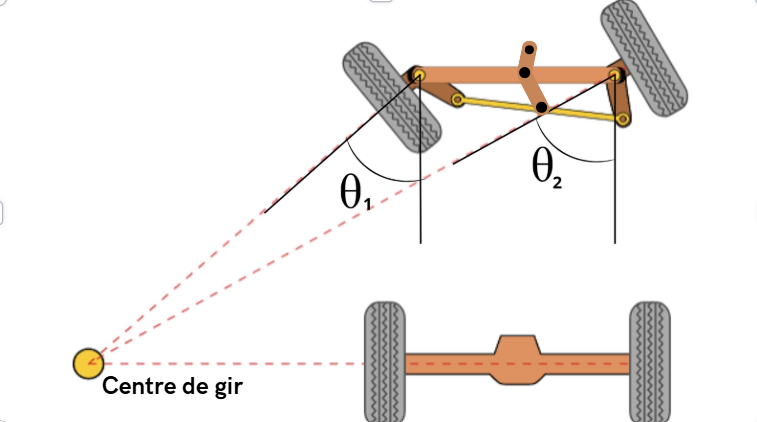

*Imatge 3: Geometria d’Ackermann (modificada)*

Com es pot veure en la imatge, l’angle de la roda interior (θ1) és més gran que el de l’exterior (θ2).

En aquesta captura, es pot apreciar la geometria d’Ackermann des de Fusion 360.

<a id="imatge-4"></a>

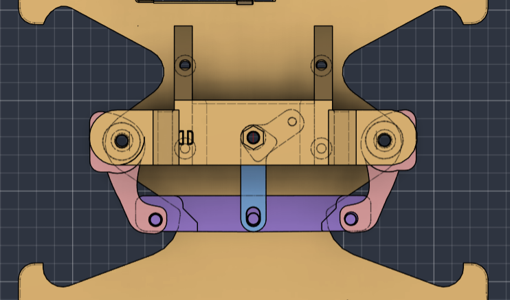

*Imatge 4: Geometria d’Ackermann del nostre cotxe. Feta des de Fusion 360.*

El que està en vermell és on van connectades les rodes, el braç lila és on van unides les dues peces vermelles i la palanca blava és on van connectats el servomotor i el braç lila per poder girar.

### 10.2. Aplicació de l’arquitectura d’Ackermann

El sistema que es va utilitzar en el primer prototip era un sistema pinyó-cremallera. Però es va decidir canviar-lo perquè no funcionava com es necessitava. Posteriorment es va optar per utilitzar una barra articulada connectada al servomotor, la qual és travessada per uns fixadors que s’enrosquen a les parts blaves i vermelles de la imatge següent.

El servomotor permetia controlar la posició de la direcció i estava connectat mecànicament a una barra metàl·lica que transmetia el moviment a les rodes a través d’una barra que transformava la rotació del servomotor en moviment lineal.

La versió final ha quedat així:

<a id="imatge-5"></a>

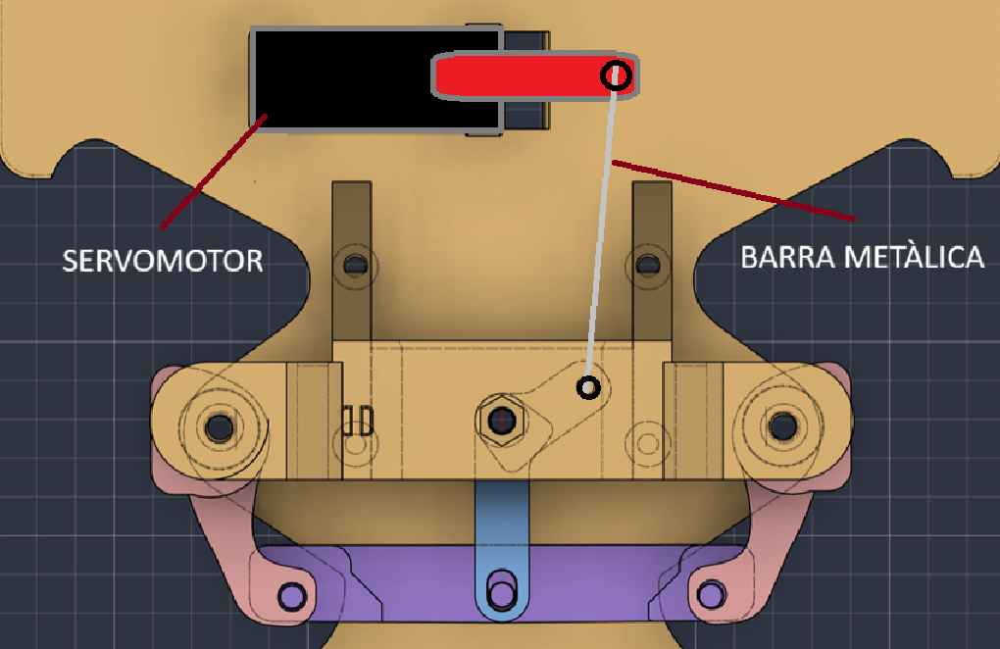

*Imatge 5: Transmissió Ackermann-servomotor. Feta des de Fusion 360.*

Tot i que el sistema anterior semblava que funcionaria, era molt poc precís i no tenia prou força per poder girar correctament. Així que hem decidit canviar el mecanisme.

D’aquesta manera, el moviment del servomotor es transmet directament a la barra de gir i aquesta produeix el moviment de les rodes. El servomotor va instal·lat sobre la direcció, perquè d’aquesta manera es produeix un moviment més precís i directe.

<a id="imatge-6"></a>


*Imatge 6: Instal·lació final del servomotor. Feta des de Fusion 360.*

### 10.3. Transmissió del diferencial

El grup diferencial d’un vehicle terrestre es va crear el 1827 per als cotxes impulsats a vapor. Servia per transmetre la força del motor als eixos de les rodes de forma asimètrica quan el vehicle girava en un revolt.

Avui dia s’utilitza en tots els vehicles terrestres (excepte motocicletes) i fa la mateixa funció que fa gairebé dos-cents anys, tot i que s’ha anat millorant al llarg dels anys.

Hem volgut aplicar-lo al nostre cotxe per la mateixa raó que la geometria d’Ackermann i perquè així sigui més estable i no derrapi als revolts fent que la roda de l’exterior giri més de pressa que la de l’interior.

Consta d’un conjunt d’engranatges anomenats planetaris, inserits dins d’una caixa metàl·lica i girats 90° entre ells, i una corona (un engranatge més gran) que està unida a la caixa. El moviment rotatori del motor es transmet a través d’un pinyó d’atac, que està connectat a 90° de la corona.

<a id="imatge-7"></a>

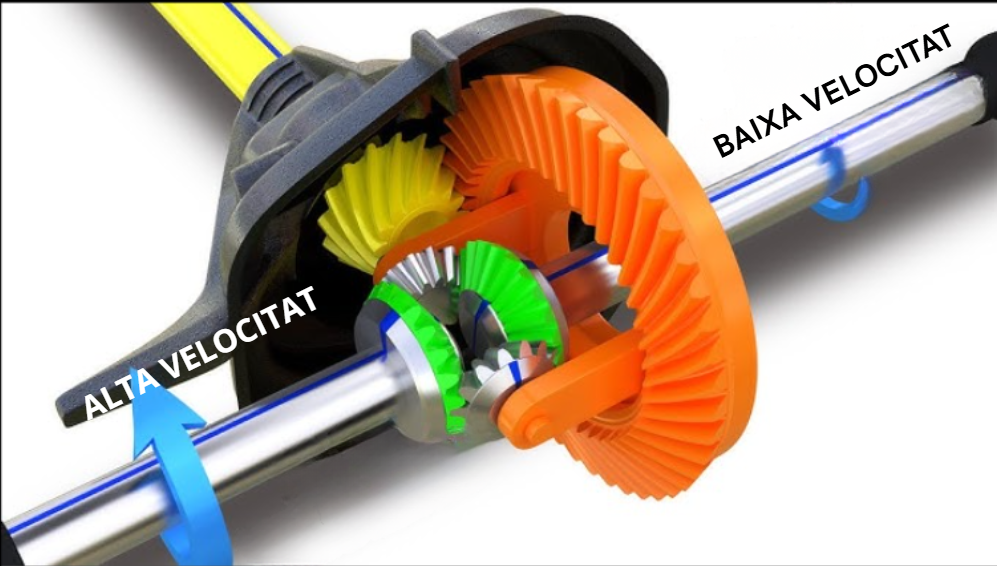

*Imatge 7: Funcionament del diferencial (modificada)*

Aquest és el nostre diferencial extret de Makerworld[^1] i modificat per nosaltres gràcies a lu_print.

[^1]: Makerworld és una pàgina web on pots penjar i trobar dissenys per imprimir en 3D de forma gratuïta.

### 10.4. Aplicació del diferencial

En el nostre cas, el diferencial es va fer amb impressió 3D. El model inicial es va modificar per adaptar-lo al nostre vehicle. Es va fer un forat en cada un dels engranatges que van connectats als eixos de les rodes, ja que s’han utilitzat unes barres metàl·liques per transmetre el moviment directament a les rodes.

Aquesta modificació va permetre adaptar el diferencial al sistema de muntatge del nostre cotxe. Aquí es pot veure com ha quedat en el prototip final:

<a id="imatge-8"></a>


*Imatge 8: Diferencial del prototip final*

## 11. IMPRESSORES 3D

Per poder realitzar aquest projecte, s’han hagut d’utilitzar impressores 3D per crear-ho tot, des de les rodes fins al xassís. Hem fet servir impressores 3D de filament, ja que són les més adequades per fer el treball.

### 11.1. Com funcionen?

Una impressora 3D de filament diposita plàstic fos sobre una superfície llisa i calenta. El capçal, mogut per motors pas a pas i corretges, controla el flux de plàstic i la seva posició.

Aquest procés el va fent capa per capa fins que la peça està completada.

La màquina llegeix un codi escrit en G-code[^2] generat per un laminador a partir de la peça que es vol imprimir. Aquest codi es descarrega o s’envia a la impressora per Wi-Fi, i la impressora imprimeix la peça automàticament.

[^2]: El G-code és un llenguatge de programació utilitzat per controlar màquines automàtiques com impressores 3D, fresadores CNC, talladores làser i torns. Actua com un traductor que converteix un model digital en una sèrie d’instruccions que són les que llegeix la màquina.

### 11.2. Quina impressora 3D hem utilitzat?

Avui en dia, hi ha un gran ventall de marques d’impressores 3D, com ara Prusa, Creality o Bambu Lab. A la nostra disposició teníem la Bambu Lab H2D i la Bambu Lab P1S, les quals són de les impressores 3D més conegudes del mercat actual.

Tenen una qualitat i una rapidesa d’impressió excepcionals, cosa que ens garanteix una bona impressió i menys errades gràcies als seus sistemes d’intel·ligència artificial i CoreXY. El CoreXY és un sistema en què el capçal de la impressora es controla amb dos motors pas a pas independents i corretges.

La H2D es va utilitzar principalment per fabricar el xassís i les rodes, mentre que la P1S es va utilitzar per als engranatges, prototips petits i altres peces.

La utilització de dues impressores va permetre repartir la fabricació de les diferents peces segons les necessitats de cada impressió.

#### *11.2.1. Bambu Lab P1S*

La Bambu Lab P1S és una de les primeres impressores tancades que va fer Bambu Lab, i incorpora la tecnologia CoreXY. Destaca per la facilitat de muntatge, velocitat i fiabilitat. Inclou un volum d’impressió estàndard de 256 x 256 x 256 mm i porta un filtre de carboni per captar partícules perilloses en escalfar materials tècnics com l’ABS.

Només té un *nozzle* (extrusor per on surt el filament plàstic desfet) i per canviar de color o material s’ha de fer manualment o utilitzar el sistema AMS (de l’anglès Automatic Material System), que ho fa automàticament.

<a id="imatge-9"></a>

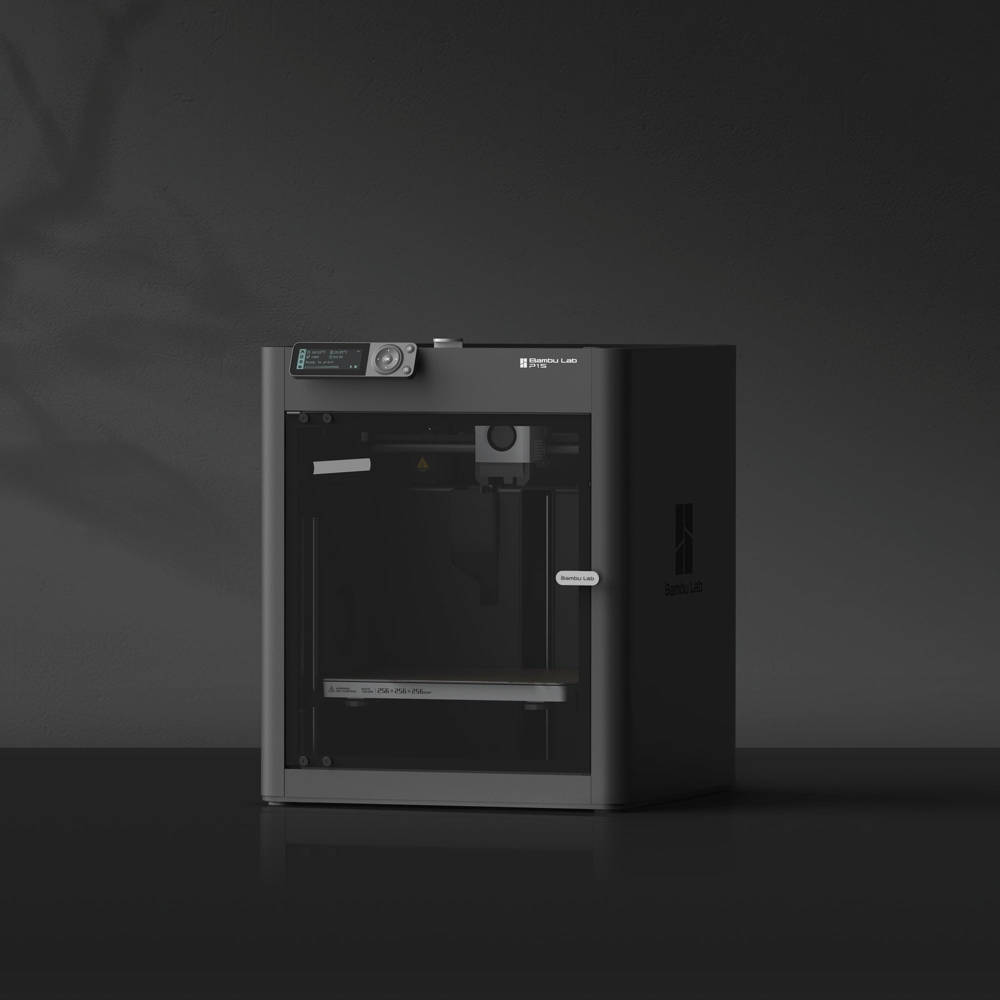

*Imatge 9: Bambu Lab P1S*

#### *11.2.2. Bambu Lab H2D*

La Bambu Lab H2D és una de les primeres impressores tancades tot en un de tipus industrial, i incorpora la tecnologia CoreXY millorada respecte de la P1S.

Destaca per ser una plataforma híbrida de fabricació que combina impressió 3D ultraràpida, gravat i tall làser, i traçat a paper. Inclou un volum d’impressió molt més ampli, de 350 x 320 x 325 mm, i porta un potent sistema de ventilació amb filtre de carboni i cambra calefactada activa a 65 °C per treballar de manera segura amb materials tècnics avançats a altes temperatures.

A diferència de models anteriors, compta amb un doble *nozzle* (dos extrusors independents), la qual cosa permet combinar materials rígids i flexibles com el TPU sense embussos.

<a id="imatge-10"></a>

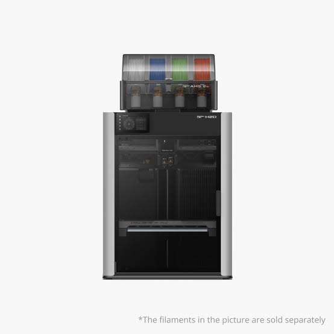

*Imatge 10: Bambu Lab H2D*

### 11.3. Paràmetres d’impressió

Per a les impressions realitzades es van utilitzar principalment els següents paràmetres:

<a id="taula-4"></a>

*Taula 4: Paràmetres d’impressió*

| Paràmetre | Valor |
|---|---|
| Alçada de capa | 0,2 mm |
| Infill | 15 % |
| Nombre de parets | 3 |
| Temperatura PLA | 220 °C |
| Temperatura PETG | 255 °C |
| Suports | Sí, en el xassís |

L’alçada de capa és la separació que hi ha entre les capes de les peces.

L’*infill* (o farciment) és l’estructura interna de la peça: per estalviar temps i material, es genera un patró que suporta tota la peça i fa que sigui més resistent.

El nombre de parets és la quantitat de capes de plàstic que formen el contorn exterior de la peça, separant la superfície de l’*infill* intern.

Els suports són estructures provisionals que aguanten les parts de la peça que queden suspeses a l’aire o tenen molta inclinació; sense ells, les peces sortirien malament.

## 12. MATERIALS UTILITZATS

La impressió 3D utilitza una gran varietat de materials, cadascun dels quals s’adapta a diferents tecnologies i aplicacions, des de la rapidesa i facilitat d’ús fins a la resistència mecànica o tèrmica.

### 12.1. Quins materials teníem disponibles?

Per poder realitzar el nostre projecte usant impressores 3D, teníem tres opcions:

- **PLA (Àcid Polilàctic):** El material més comú i fàcil d’imprimir, s’imprimeix de 180 a 220 °C i és biodegradable. És ideal per a maquetes, decoració i prototips ràpids, però és poc resistent a la calor.
- **PETG (Polietilè tereftalat de glicol):** Té la facilitat d’impressió del PLA amb la resistència del material de les ampolles de plàstic, s’imprimeix de 220 a 255 °C. És més flexible que el PLA, resistent a l’aigua i als impactes.
- **ABS (Acrilonitril butadiè estirè):** Molt resistent i durador, aguanta bé les altes temperatures i es pot polir amb acetona, s’imprimeix de 230 a 250 °C. Requereix impressora tancada per evitar que es deformi durant la impressió.

### 12.2. Materials per a cada peça

Els principals materials utilitzats en la fabricació van ser PLA i PETG.

El PLA utilitzat era de Bambu Lab i Creality, mentre que el PETG utilitzat era de Creality.

La distribució dels materials va ser la següent:

<a id="taula-5"></a>

*Taula 5: Materials per a cada peça*

| Peça | Material |
|---|---|
| Xassís | PLA |
| Rodes | PLA |
| Diferencial | PETG |
| Engranatges | PETG |
| Suports | PLA |
| Altres peces | PLA |

El PLA es va utilitzar principalment en peces estructurals i altres parts del vehicle, mentre que el PETG es va utilitzar en peces que formen part del sistema de transmissió, com el diferencial i els engranatges.

# BLOC IV: PROGRAMACIÓ

## 13. EXPLICACIÓ DE ROS 2

ROS 2 (Robot Operating System 2) és un *framework* de programari dissenyat principalment per al desenvolupament de sistemes robòtics. Permet executar diversos programes de manera simultània, compartir dades entre aquests programes i establir comunicació entre els diferents components del sistema.

ROS 2 funciona principalment mitjançant un sistema de *nodes* i *topics*. Cada *node* és un programa que realitza una determinada funció, mentre que els *topics* són canals de comunicació que permeten transmetre dades entre els diferents *nodes*.

Un *node* pot publicar dades en un *topic*, és a dir, enviar informació, o pot estar subscrit a un *topic*, de manera que rep les dades que es publiquen en aquest canal. D’aquesta manera, diferents programes poden treballar de forma independent però compartir la informació necessària.

A més dels *nodes* i els *topics*, un projecte de ROS 2 necessita una determinada estructura d’arxius i directoris perquè pugui ser compilat i executat correctament. Alguns directoris, com `build`, `install` i `log`, són generats automàticament durant el procés de compilació amb `colcon build`, que és la comanda per compilar els repositoris de ROS 2.

D’altra banda, hi ha arxius que formen part de l’estructura del paquet i que han de ser configurats pel programador. Entre aquests es troben `package.xml`, `setup.py` i, segons el tipus de paquet, `CMakeLists.txt`. També existeixen directoris com `src`, on es troba el codi font del projecte, i els diferents directoris interns del paquet.

En aquest projecte s’ha utilitzat la versió ROS 2 Jazzy. La guia oficial per instal·lar-la es pot trobar a: [Instal·lació de ROS 2 Jazzy](https://docs.ros.org/en/jazzy/Installation.html).

<a id="imatge-11"></a>


*Imatge 11: Exemple simple del funcionament de ROS 2*

### 13.1. Estructura d’un node

El codi complet d’aquest exemple es troba a l’[Annex 1](#annex-1).

Aquest exemple mostra l’estructura bàsica d’un *node* de ROS 2 desenvolupat en Python.

En primer lloc es troben els *imports*, que incorporen les biblioteques i els tipus de missatge necessaris. En aquest cas, `rclpy` proporciona les eines necessàries per treballar amb ROS 2, `Node` permet crear el *node* i `String` és el tipus de missatge utilitzat.

```python
import rclpy
from rclpy.node import Node
from std_msgs.msg import String
```

A continuació es defineix la classe del *node*, que hereta de `Node`. Aquesta classe conté els elements que determinen el comportament del *node*.

```python
class MyNode(Node):
```

El mètode `__init__()` és el constructor i s’executa quan es crea una instància del *node*. En aquest apartat es configura el *node* i es creen els elements de comunicació. En l’exemple es crea un *subscriber*, que rep missatges del *topic* `my_topic`, i un *publisher*, que permet publicar-hi missatges.

```python
    def __init__(self):
        super().__init__('my_node')

        self.subscription = self.create_subscription(
            String,
            'my_topic',
            self.listener_callback,
            10
        )
        self.publisher = self.create_publisher(
            String,
            'my_topic',
            10
        )
```

El *subscriber* està associat a la funció `listener_callback()`. Aquesta funció és un *callback*, és a dir, una funció que ROS 2 executa quan es rep un missatge en el *topic* al qual el *node* està subscrit. És on es troba el codi executable com a tal.

```python
    def listener_callback(self, msg):
        print('Missatge rebut:', msg.data)
```

Finalment, la funció `main()` s’encarrega de la inicialització i execució del *node*.

```python
def main(args=None):
    rclpy.init(args=args)

    node = MyNode()
    rclpy.spin(node)
    node.destroy_node()
    rclpy.shutdown()
```

## 14. PLANIFICACIÓ DEL CODI

El sistema segueix la idea d’un SLAM (*Simultaneous Localization and Mapping*): el cotxe calcula on és mentre construeix el mapa del circuit. El codi està dividit en quatre blocs, i cada bloc està format per diversos *nodes* de ROS 2 que s’envien la informació a través de *topics*:

1. **Localització:** calcula la posició i l’orientació del cotxe a partir de la velocitat de les rodes (*encoder*), de la IMU i de l’angle de direcció, utilitzant el Bicycle Model.
2. **Mapatge:** llegeix el LiDAR, converteix les lectures en punts del pla, detecta els cons i els afegeix a un mapa global. Amb aquests cons també corregeix la posició calculada per la localització.
3. **Planificació de la trajectòria (*path plan*):** a partir del mapa de cons, calcula la traçada que ha de seguir el cotxe pel mig del circuit.
4. **Control:** fa que el cotxe segueixi aquesta traçada: calcula l’angle de direcció (Pure Pursuit), manté la velocitat objectiu (PID) i envia les ordres al servomotor i als motors.

A més, hi ha un sistema de seguretat amb sensors de proximitat que pot corregir la direcció si els altres blocs fallen.

Resumint, la informació circula així:

```text
sensors → localització → mapatge → path plan → control → motors i servo
```

Cada vegada que el LiDAR completa una volta, aquest cicle es repeteix, de manera que el cotxe treballa sempre amb les dades més recents. Als apartats següents s’explica cada bloc amb detall, i a l’apartat 19 es pot veure l’esquema complet de com es connecten tots els *nodes*.

## 15. LOCALITZACIÓ

Aquest bloc s’encarrega de localitzar el cotxe i està format pels *nodes*:

- `src/codi_principal/nodes/location/motor_reader`
- `src/codi_principal/nodes/location/imu/imu_reader`

Que s’encarreguen de llegir les dades de la IMU i de l’*encoder* del motor perquè es puguin utilitzar a la resta del sistema.

i el *node* principal:

- `src/codi_principal/nodes/location/bicycle_model/bicycle_model`

Que s’encarrega d’utilitzar les lectures per calcular la posició del cotxe en tot moment.

### 15.1. Bicycle Model

L’objectiu d’aquest *node* és localitzar el cotxe, és a dir, calcular la seva posició (x,y) i la seva orientació al llarg del temps.

Per fer aquest càlcul, primer cal conèixer la velocitat del cotxe, que s’obté combinant les lectures de l’*encoder* i de la IMU mitjançant un filtre complementari:

```text
v = α · (v + a · Δt) + (1 − α) · v_encoder
```

On α és un valor entre 0 i 1 que indica quant es confia en l’acceleròmetre respecte a l’*encoder*. L’acceleròmetre de la IMU detecta ràpidament els canvis de velocitat, mentre que l’*encoder* evita que l’error que es comet en integrar l’acceleració s’acumuli amb el temps. A més, quan l’*encoder* indica que les rodes estan aturades, la velocitat es considera zero, perquè el petit error de l’acceleròmetre no faci avançar el cotxe quan està quiet.

Utilitzant aquesta velocitat i l’angle de les rodes, el *node* pot calcular com varia l’orientació del cotxe i, a partir d’aquesta, el seu desplaçament en els eixos x i y. Per fer-ho utilitza l’algoritme Bicycle Model, anomenat així perquè permet simplificar el moviment d’un cotxe representant-lo com si fos una bicicleta.

Aquest model considera que el moviment del vehicle depèn principalment de la velocitat, de l’angle de les rodes i de la distància entre els eixos. A partir d’aquests paràmetres es pot calcular el radi de gir mitjançant:

```text
R = L / tan(δ)
```

On:

- R = radi de gir.
- L = distància entre l’eix davanter i l’eix posterior.
- δ = angle de les rodes respecte de l’eix longitudinal del cotxe.

Un cop conegut el radi de gir, es pot calcular la velocitat angular del cotxe:

```text
ω = v / R
```

I, substituint el radi de gir:

```text
ω = (v / L) · tan(δ)
```

El temps transcorregut entre dues actualitzacions també es té en compte, de manera que en cada iteració es calcula una nova posició:

```text
x_nova = x + v · cos(θ) · Δt
y_nova = y + v · sin(θ) · Δt
```

I una nova orientació:

```text
θ_nova = θ + (v / L) · tan(δ) · Δt
```

Així, el *node* estima contínuament la posició i l’orientació del cotxe a partir del seu moviment.

<a id="imatge-12"></a>

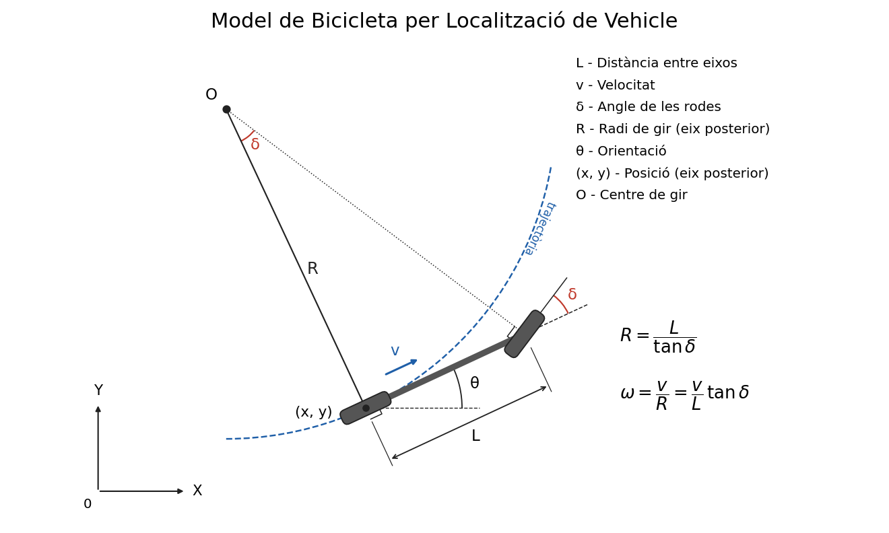

*Imatge 12: Dibuix orientatiu del Bicycle Model*

## 16. MAPATGE

Aquest bloc construeix el mapa del circuit a partir de les dades de localització del cotxe, prèviament processades, i de les dades obtingudes mitjançant el LiDAR.

El codi encarregat de llegir el LiDAR es troba a `src/lidar_drivers` i no ha estat desenvolupat pel programador del grup. Es tracta del codi recomanat pel fabricant d’acord amb les especificacions del sensor (*datasheet*). Aquest codi publica, després de cada volta completa del LiDAR, les dades de lectura en forma de coordenades polars (distància i angle) al *topic* `/ldlidar_node/scan`, amb missatges de tipus `LaserScan`.

Els *nodes* que formen el bloc de mapatge són:

- `src/codi_principal/nodes/mapping/lidar/lidar_image_creator`
- `src/codi_principal/nodes/mapping/lidar/lidar_processing`

Primer de tot, cal definir què són les coordenades locals i globals per tal d’entendre tot el que s’explica a continuació.

Les coordenades locals són les que tenen com a referència el mateix cotxe. El seu origen és el LiDAR, l’eix x apunta cap a la part davantera del cotxe i l’eix y cap a l’esquerra. Les dades que llegeix el LiDAR estan en aquestes coordenades, i per això canvien quan el cotxe es mou: un mateix con, que no es mou del circuit, té unes coordenades locals diferents cada vegada que el cotxe canvia de posició o d’orientació.

Les coordenades globals, en canvi, tenen com a referència un punt fix del circuit, que és la posició on comença el cotxe. Així, cada con té sempre les mateixes coordenades globals, independentment d’on es trobi el cotxe. Aquestes són les coordenades que s’utilitzen per localitzar el cotxe i per construir el mapa.

### 16.1. lidar_image_creator

Aquest *node* està subscrit al *topic* `/ldlidar_node/scan` i s’encarrega de processar les dades obtingudes del LiDAR. Les seves funcions principals són eliminar lectures errònies, convertir les coordenades polars a coordenades cartesianes, transformar les coordenades locals a coordenades globals i corregir la distorsió provocada pel moviment del cotxe durant l’escaneig.

La conversió de coordenades polars a cartesianes es realitza mitjançant raons trigonomètriques. A partir de la distància i l’angle de cada punt, es calculen les seves coordenades X i Y. Posteriorment, les coordenades locals es transformen en coordenades globals tenint en compte la posició i l’orientació del cotxe. D’aquesta manera, els punts detectats pel LiDAR es poden situar correctament dins del mapa global.

La tasca més complexa és corregir la distorsió provocada pel moviment del cotxe durant el temps que el LiDAR necessita per completar una lectura. Com que el LiDAR publica les dades en completar una volta, el primer punt de la lectura tindrà un error equivalent al desplaçament del cotxe durant la lectura, i aquest error anirà disminuint fins a l’últim punt, que té un error zero. Per solucionar-ho, el codi estima la posició del cotxe en el moment en què es va capturar cada punt. Per fer-ho, utilitza la mateixa fórmula emprada per calcular la posició del cotxe i estima quant s’ha desplaçat i rotat entre la captura de cada punt i el moment actual. El temps entre punts es calcula a partir del temps necessari per rebre les diferents lectures i es distribueix entre els punts de l’escaneig. D’aquesta manera, es pot compensar el moviment del cotxe i obtenir una representació dels punts molt més fidel a la seva posició real.

<a id="imatge-13"></a>


*Imatge 13: Distorsió de la lectura del LiDAR pel moviment del cotxe*

### 16.2. lidar_processing

Aquest *node* està subscrit al *topic* `scan_xy` i té com a objectius detectar els cons i incorporar-los al mapa global.

La detecció dels cons es realitza mitjançant un algoritme de *clustering*, que té com a objectiu agrupar punts que es troben prou a prop els uns dels altres. Per entendre el funcionament de l’algoritme, suposem que `scan_xy` ha detectat els punts A, B, C i D. Primer, l’algoritme crea una matriu anomenada `cluster` i hi afegeix el punt A. A continuació, compara la distància entre A i B mitjançant el teorema de Pitàgores. Si la distància és inferior a un valor llindar preestablert, anomenat *threshold*, es considera que els dos punts pertanyen al mateix grup. En aquest cas, es calcula la mitjana ponderada de les seves coordenades i s’utilitza aquest valor com a representació del grup. Si la distància és superior al *threshold*, el punt B es considera un punt diferent i s’afegeix a la matriu `cluster`. A continuació, el punt C es compara amb els grups existents i es repeteix el mateix procés. Aquest procediment continua fins que s’han processat tots els punts de `scan_xy`. Per evitar considerar com a cons els grups formats per punts aïllats o per lectures errònies, s’utilitza un comptador de punts. Aquest comptador registra quants punts formen part de cada grup. Si un grup no arriba a un mínim de 3 punts, es descarta. Com a resultat, s’obté una matriu que conté únicament els cons detectats durant una volta del LiDAR. Aquesta matriu és temporal i es torna a generar cada vegada que el LiDAR completa una nova volta.

La creació del mapa global utilitza un algoritme similar al de la detecció de cons. La principal diferència és que, en aquest cas, la matriu a la qual s’aplica l’algoritme és la resultant del *clustering* anterior, és a dir, la matriu `cluster` amb els cons detectats en l’escaneig actual. A més, el resultat, que és el mapa, es conserva cada vegada que s’executa l’algoritme, en lloc de tornar-se a generar a cada volta del LiDAR. Quan es detecta un con que ja forma part del mapa, la seva posició s’actualitza a partir de la nova mesura. D’aquesta manera, les diferents deteccions del mateix con es poden combinar i reduir l’error de la seva posició. Per tant, a mesura que el cotxe realitza més voltes i obté noves mesures, el mapa es va actualitzant i les posicions dels cons es poden determinar amb més precisió.

### 16.3. Integració de la localització

El procés de localització té un problema d’acumulació d’error. Per solucionar-ho, es va optar per utilitzar també el LiDAR per localitzar el cotxe. Aquesta correcció també es calcula dins del *node* `lidar_processing`, en lloc de fer-se en un *node* independent.

Això es deu al fet que la informació necessària per actualitzar la posició dels cons és principalment la diferència entre les posicions obtingudes en les diferents deteccions. El programa calcula aquestes diferències, en determina la mitjana i l’aplica a la posició actual del cotxe.

D’aquesta manera, no és necessari crear un *node* addicional que realitzi aquest càlcul. Això permet reduir la quantitat de processos que s’executen simultàniament i, per tant, disminuir la càrrega de la CPU.

## 17. PLANIFICACIÓ DE LA TRAJECTÒRIA

L’objectiu d’aquest bloc és utilitzar el mapa de cons per crear una traçada que el vehicle pugui seguir. L’algoritme utilitzat està basat en el desenvolupat per l’equip de Formula Student FaSTTUBe (Formula Student Team TU Berlin). Ha resultat especialment pràctic per al nostre projecte, ja que les competicions de Formula Student inclouen proves de conducció autònoma i aquest equip també utilitza un LiDAR per obtenir informació del circuit.

A causa de la seva complexitat, el codi d’aquest bloc no ha estat desenvolupat directament pel programador del grup. Per aquest motiu, en aquest apartat se’n farà una explicació breu i simplificada.

L’algoritme es divideix en dues fases principals:

### 17.1. Separació dels cons

En primer lloc, l’algoritme analitza el mapa i intenta determinar quins cons corresponen a la banda esquerra del circuit i quins corresponen a la banda dreta. Això ho fa mitjançant un algoritme que calcula l’angle entre dos cons i, si no és gaire tancat, els situa a la mateixa banda del circuit.

Aquesta separació és necessària perquè posteriorment l’algoritme pugui determinar l’espai que hi ha entre les dues bandes del circuit.

### 17.2. Generació de la trajectòria

L’algoritme genera triangles entre punts de les dues bandes del circuit, els triangles resultants tindran dos vèrtexs que coincidiran amb punts d’una banda i un tercer amb un punt de l’altra banda. L’algoritme llavors buscarà el punt mitjà dels dos costats que inclouen el tercer con. Finalment, es generen punts addicionals entre els punts obtinguts per reduir la distància entre ells i aconseguir una trajectòria més contínua i adequada per al seguiment del vehicle.

<a id="imatge-14"></a>

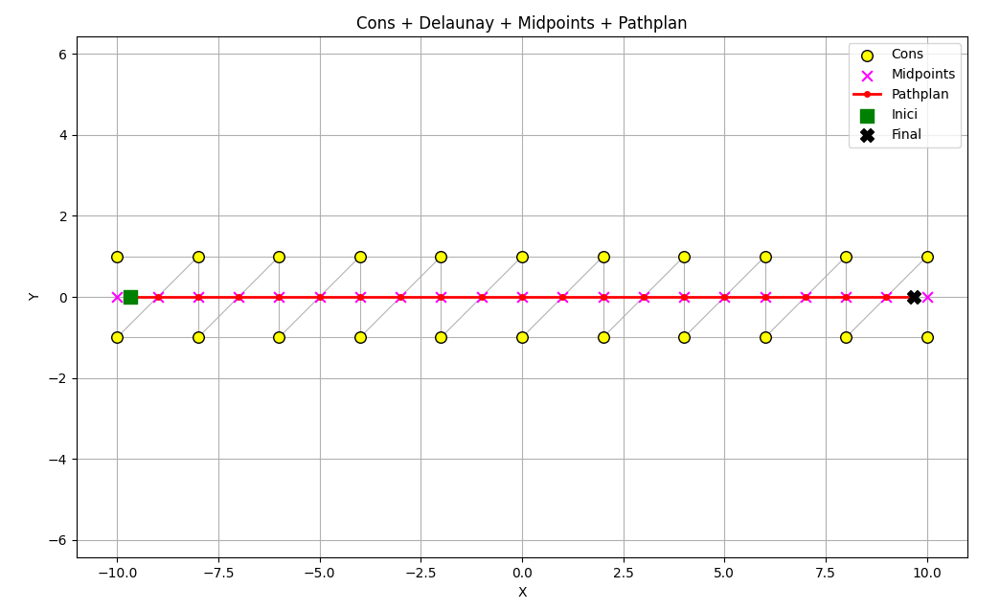

*Imatge 14: Simulació del path plan en una recta*

### 17.3. Bridge

Per poder utilitzar aquest algoritme dins del projecte s’han creat un *node* i un mòdul auxiliar:

- `src/codi_principal/nodes/path_planning/path_planner_bridge_node.py`
- `src/codi_principal/nodes/path_planning/bridge_utils.py`

El *node* `path_planner_bridge_node.py` actua com a pont entre el nostre sistema i l’algoritme de planificació de la trajectòria, gestionant-ne la comunicació i fent possible la seva integració amb la resta del projecte. El mòdul `bridge_utils.py` no és un *node*, sinó un conjunt de funcions auxiliars que el *node* utilitza per convertir el mapa de cons al format que necessita l’algoritme.

## 18. CONTROL

Finalment, tenim el sistema de control, que té la tasca de controlar i conduir el cotxe. Aquest sistema s’encarrega principalment del control de la velocitat i del control de la direcció.

### 18.1. Control de velocitat

El control de velocitat es realitza mitjançant un PID (Proporcional, Integral i Derivatiu). Es tracta d’un algoritme de control que té com a objectiu mantenir una variable en un valor desitjat, també anomenat *setpoint*. En aquest cas, la variable controlada és la velocitat del cotxe, mentre que el valor objectiu serà una velocitat determinada.

El PID calcula contínuament la diferència entre la velocitat objectiu i la velocitat real mesurada. A partir d’aquest error, calcula la correcció que s’ha d’aplicar utilitzant tres components:

- **Proporcional (P):** reacciona a l’error actual. Com més gran sigui l’error, més gran serà la correcció aplicada.
- **Integral (I):** acumula els errors produïts al llarg del temps. Serveix per corregir errors persistents que el component proporcional, per si sol, no és capaç d’eliminar.
- **Derivatiu (D):** analitza com està canviant l’error i permet anticipar-ne l’evolució. Això ajuda a reduir les oscil·lacions i evita que el sistema sobrepassi excessivament el valor objectiu.

La correcció que s’aplica als motors és la suma dels tres components:

```text
correcció = Kp · e + Ki · ∫e dt + Kd · de/dt
```

En el nostre cotxe, els valors utilitzats són Kp = 0,8, Ki = 0,02 i Kd = 0,1, la velocitat objectiu és de 0,5 m/s i el càlcul es repeteix cada 0,1 s.

<a id="imatge-15"></a>

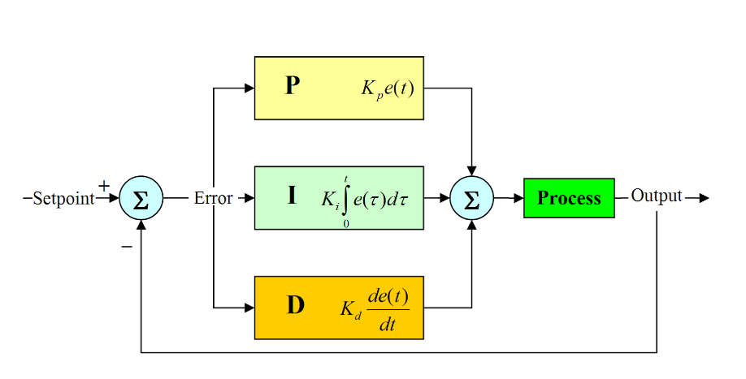

*Imatge 15: Explicació PID*

D’aquest control de velocitat se n’encarrega el *node*:

- `src/codi_principal/nodes/control/speed_control`

### 18.2. Control de la direcció

Per controlar la direcció del cotxe s’utilitzen dos sistemes diferents: un sistema principal encarregat de seguir la trajectòria calculada i un sistema de seguretat que serà utilitzat en cas que, en provar el cotxe, el sistema principal no funcioni, per tal que el dia de la presentació hi hagi un mínim que permeti ensenyar el funcionament de la resta del cotxe.

#### *18.2.1. Seguiment de la trajectòria*

El sistema principal de control de la direcció es troba al *node*:

- `src/codi_principal/nodes/control/path_follower`

L’algoritme utilitzat és el Pure Pursuit. El seu funcionament consisteix a crear un cercle imaginari al voltant del cotxe amb un radi determinat, conegut com a *lookahead distance*. A continuació, busca un punt de la trajectòria o *path plan* que es trobi sobre el perímetre d’aquest cercle.

<a id="imatge-16"></a>


*Imatge 16: Funcionament del Pure Pursuit*

Un cop seleccionat aquest punt, l’algoritme calcula quin ha de ser el radi de gir del cotxe perquè aquest pugui arribar al punt seleccionat. A partir d’aquest radi de gir es calcula l’angle de direcció necessari.

Concretament, si α és l’angle entre la direcció del cotxe i el punt seleccionat, l_d és la distància fins a aquest punt i L és la distància entre eixos, el radi de gir necessari per arribar al punt és:

```text
R = l_d / (2 · sin(α))
```

Substituint aquest radi a la fórmula R = L / tan(δ) del Bicycle Model (apartat 15.1), s’obté l’angle de direcció:

```text
δ = atan(2 · L · sin(α) / l_d)
```

En el nostre cotxe s’utilitza una *lookahead distance* de 0,2 m, i l’angle resultant es limita a l’angle màxim que permet el sistema de direcció.

Aquest algoritme resulta especialment útil perquè no reacciona únicament a la posició actual del vehicle, sinó que té en compte un punt situat més endavant en la trajectòria. D’aquesta manera, el cotxe pot anticipar-se als girs que haurà de realitzar.

#### *18.2.2. Sistema de seguretat*

El segon sistema de control es troba al *node*:

- `src/codi_principal/nodes/control/proximity_sensors`

Aquest sistema utilitza els dos sensors de proximitat del cotxe per detectar la presència de parets o obstacles propers.

Utilitzant un altre controlador PID, anteriorment explicat, el sistema modifica la direcció del vehicle amb l’objectiu d’evitar una col·lisió. Es tracta d’un algoritme relativament simple, però pot evitar que el cotxe xoqui.

### 18.3. Comunicació amb el servomotor

Finalment, el *node*:

- `src/codi_principal/nodes/control/steering`

És l’encarregat de comunicar-se directament amb el servomotor de direcció. Aquest *node* transforma l’angle de direcció calculat pels diferents sistemes de control en una ordre adequada per al servomotor, cosa que permet moure físicament les rodes fins a la posició necessària.

## 19. ORGANITZACIÓ GLOBAL

En el següent esquema ([Annex 2](#annex-2)) es mostra l’organització del sistema. Com es pot veure a la llegenda, els diferents elements es representen mitjançant formes i colors segons la seva funció.

### 19.1. Llegenda

Les formes rodones representen els *nodes*, i els rombes, els *topics* o les lectures dels sensors. Alguns *topics* no estan representats explícitament perquè no són importants per entendre el funcionament general del sistema; en aquests casos, simplement es mostra la fletxa i es dona per fet que existeix un *topic* entre els elements.

Alguns *topics*, com `location_solved` i `steering_angle`, apareixen dues vegades al diagrama, i una d’elles porta l’etiqueta `t-1`. Aquesta etiqueta indica que el *node* que els rep no utilitza el valor que s’està calculant en aquell moment, sinó el que es va publicar a la iteració anterior (l’instant t-1).

Les fletxes també es diferencien segons el tipus de comunicació:

- Les línies contínues indiquen que el *topic* activa el *node*, però la informació que conté el *topic* no és utilitzada pel *node*.
- Les línies discontínues indiquen que el *topic* transmet informació al *node*, però no activa el *node*.
- Les línies de guions i punts indiquen que el *topic* activa el *node* i, al mateix temps, li transmet informació.

Finalment, els colors indiquen a quin bloc del codi pertany cada element. El color verd correspon al bloc de localització, el lila al bloc de mapatge, el groc al bloc de *path plan* i el vermell al bloc de control.

### 19.2. Explicació

Com es pot veure, el funcionament del codi comença amb la lectura del LiDAR (LaserScan). Aquesta lectura activa els *nodes* encarregats de llegir la velocitat i altres dades necessàries per poder localitzar el cotxe.

Un cop finalitzada la localització, s’activen els algoritmes de mapatge. D’aquesta manera, com que per realitzar la localització és necessari disposar de les dades del LaserScan, i el processament de la localització triga més temps que el processament necessari perquè el LaserScan arribi a `lidar_image_creator`, els *nodes* de mapatge no poden començar a treballar fins que no disposen de totes les dades necessàries.

Seguidament, `lidar_processing` calcula la nova localització del cotxe i la transmet a `bicycle_model`. D’aquesta manera, el LaserScan actua com una mena de rellotge del sistema, ja que marca el ritme d’actualització i assegura que, en cada iteració, es treballi amb les dades més actuals disponibles.

Finalment, a partir del mapa actualitzat es calcula el *path plan* i, amb aquest, es fa el control del cotxe. Aquests *nodes* segueixen la mateixa norma: cada *node* s’activa quan rep la dada que triga més a arribar, de manera que sempre treballa amb la informació més recent.

## 20. SIMULACIÓ I LAUNCHERS

### 20.1. Simulació

Per poder provar el codi sense haver d’utilitzar el cotxe real, s’ha creat un simulador, que es troba al paquet `src/car_simulator`.

El simulador recrea dues coses: el moviment del cotxe i la lectura del LiDAR. Per una banda, calcula com es mou el cotxe a partir de l’angle de direcció i la velocitat que li envia el codi de control, utilitzant el mateix Bicycle Model explicat a l’apartat 15.1. Per l’altra, a partir de la posició del cotxe i d’un mapa amb la posició dels cons, genera les mateixes dades que enviaria el LiDAR real.

D’aquesta manera, la resta del sistema (mapatge, *path plan* i control) és exactament el mateix codi que s’executa al cotxe, i el resultat es pot veure a RViz2.

<a id="imatge-17"></a>

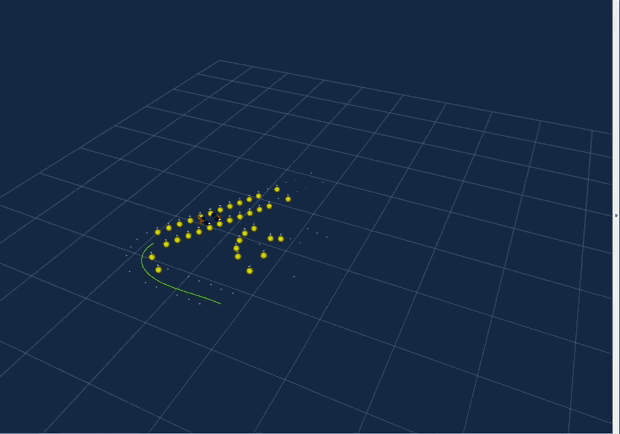

*Imatge 17: Simulació del cotxe a RViz2*

Per executar la simulació s’utilitza la comanda:

```bash
ros2 launch my_pakage simulation_full.launch.py track:=bcn
```

El paràmetre `track` permet escollir el circuit (`bcn` o `realista`).

### 20.2. Launchers

Com que el projecte està format per molts *nodes* que s’han d’executar alhora, s’utilitzen *launchers*, que són fitxers que inicien tots els *nodes* necessaris amb una sola comanda. Es troben a `src/codi_principal/launch`.

El *launcher* principal és `full_car.launch.py`, que és el que s’utilitza al cotxe real. Inicia tots els *nodes* del sistema: el *driver* del LiDAR, la lectura de l’*encoder* i la IMU, la localització, el mapatge, el *path plan*, el control de velocitat i la direcció. A més, tots els paràmetres físics del cotxe es troben definits al principi d’aquest fitxer, de manera que si es canvia alguna peça només cal modificar-los en un sol lloc.

Per executar-lo s’utilitza la comanda:

```bash
ros2 launch my_pakage full_car.launch.py
```

## 21. VERSIONS

Durant el procés de programació, hem utilitzat Git, una eina de control de versions que permet gestionar els canvis del codi al llarg del desenvolupament del projecte. Entre les seves principals funcionalitats destaquen la possibilitat de recuperar versions anteriors, crear ramificacions (*branches*) per desenvolupar i provar noves funcionalitats de manera independent i publicar el codi en un repositori remot per poder-hi accedir des de diferents ordinadors.

Gràcies a aquesta eina, hem pogut mantenir un registre dels canvis i organitzar el desenvolupament del programari. En total, s’han registrat 87 versions del codi (75 a la branca principal), de les quals 22 corresponien a versions considerades potencialment definitives. A més, s’han creat 11 ramificacions per desenvolupar i provar funcionalitats noves. La majoria s’han acabat incorporant al projecte principal, però algunes s’han hagut de descartar, ja que les proves realitzades no han donat els resultats esperats.

# BLOC V: CONCLUSIONS

## 22. INCIDÈNCIES

Durant les proves del vehicle s’han produït dos incidents elèctrics.

El primer va ser l’explosió del controlador de motors DRV8833. Les causes possibles identificades van ser un curtcircuit provocat per un error de connexió o una sobrealimentació, i es van estudiar totes dues hipòtesis i es van prendre mesures. Malgrat haver comptat amb l’assessorament de diversos enginyers de telecomunicacions, no s’ha pogut determinar amb certesa l’origen de l’avaria.

El segon incident va consistir en el sobreescalfament de dos cables, que va provocar la deformació del seu aïllament de plàstic. En aquest cas, la causa identificada va ser un curtcircuit durant una de les proves.

Aquests incidents han posat de manifest la importància de verificar les connexions elèctriques, comprovar els límits de funcionament dels components i adoptar mesures de seguretat abans de realitzar les proves del sistema.

## 23. RESULTATS

En conjunt, el cotxe ha assolit resultats satisfactoris en la majoria dels àmbits del projecte.

Pel que fa a la part electrònica, un cop resolts els incidents descrits a l’apartat 22, el sistema d’alimentació ha funcionat correctament i tots els components reben una alimentació estable. Quant a les connexions, la Raspberry Pi es comunica correctament tant amb els sensors com amb els actuadors.

En l’àmbit mecànic, l’estructura ha demostrat ser prou resistent per suportar el pes del vehicle i el diferencial compleix adequadament la seva funció. La direcció, tot i no ser la solució òptima, permet assolir els objectius plantejats.

Pel que fa al programari, el codi ha funcionat segons el previst: en l’entorn de simulació, que reprodueix condicions realistes, el vehicle ha estat capaç de completar els circuits simulats.

No obstant això, alguns aspectes no han assolit el rendiment esperat. Els motors i el servomotor presenten un parell lleugerament insuficient, i el joc excessiu de les rodes provoca imprecisions en el desplaçament. A més, malgrat els esforços per mantenir un cablejat ordenat, els cables han acabat entrellaçats, fet que dificulta la identificació de cada connexió.

## 24. CONCLUSIONS

En conclusió, aquest projecte ha estat més ambiciós del que, com a estudiants de batxillerat, érem capaços d’assumir, i hi ha diversos àmbits que han quedat amb una qualitat inferior a la que esperàvem. També hi ha influït el factor econòmic, que ens ha obligat a comprar components de pitjor qualitat o, directament, a fabricar-ne alguns nosaltres mateixos, com els cons.

Més enllà del resultat, el fet que el projecte fos més gran del que podíem assumir ens ha obligat a formar-nos en eines i àmbits molt diversos, com ROS 2, Git i GitHub, Fusion 360 i el disseny 3D, l’electrònica i la robòtica. Aquest és un aprenentatge que ens acompanyarà tota la vida.

## 25. AGRAÏMENTS

Voldríem agrair la col·laboració de l’Institut Escola Industrial, del nostre tutor, Josep Maria Bergadà i dels nostres amics i familiars, David Rodríguez, Adrià Simó i Carles Simó, que ens han proporcionat tota l’ajuda i el material que ens ha fet falta al llarg del treball. També volem agrair a papalotis el codi de planificació de la trajectòria que ha publicat, en què s’ha basat aquesta part del projecte.

## ANNEXOS

<a id="annex-1"></a>

### Annex 1: Codi exemple d’un node de ROS 2

```python
import rclpy
from rclpy.node import Node
from std_msgs.msg import String


class MyNode(Node):

    def __init__(self):
        super().__init__('my_node')

        self.subscription = self.create_subscription(
            String,
            'my_topic',
            self.listener_callback,
            10
        )
        self.publisher = self.create_publisher(
            String,
            'my_topic',
            10
        )

    def listener_callback(self, msg):
        print('Missatge rebut:', msg.data)


def main(args=None):
    rclpy.init(args=args)

    node = MyNode()
    rclpy.spin(node)
    node.destroy_node()
    rclpy.shutdown()


if __name__ == '__main__':
    main()
```

<a id="annex-2"></a>

### Annex 2: Mapa conceptual del sistema

<a id="imatge-18"></a>

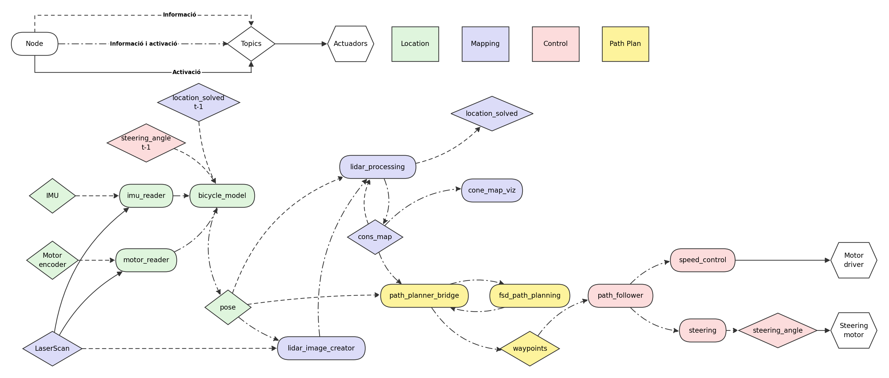

*Imatge 18: Mapa conceptual de l’organització del sistema*

<a id="annex-3"></a>

### Annex 3: Esquema de connexions del cotxe

<a id="imatge-19"></a>


*Imatge 19: Esquema de connexions del cotxe*

---

## ÍNDEX D’IMATGES

- [Imatge 1: Projecte VaMP d’Ernst Dickmanns (Mercedes 500 SEL)](#imatge-1)  
  *Font:* <https://commons.wikimedia.org/wiki/File:VAMP.png>
- [Imatge 2: Model final del cotxe](#imatge-2)  
  *Fotografia pròpia*
- [Imatge 3: Geometria d’Ackermann](#imatge-3)  
  *Imatge modificada. Font:* <https://es.wikipedia.org/wiki/Archivo:Ackermann.svg>
- [Imatge 4: Geometria d’Ackermann del nostre cotxe](#imatge-4)  
  *Captura de Fusion 360*
- [Imatge 5: Transmissió Ackermann-servomotor](#imatge-5)  
  *Captura de Fusion 360*
- [Imatge 6: Instal·lació final del servomotor](#imatge-6)  
  *Captura de Fusion 360*
- [Imatge 7: Funcionament del diferencial](#imatge-7)  
  *Imatge modificada. Font:* <https://www.motor.mapfre.es/consejos-practicos/consejos-de-mantenimiento/diferencial-coche/>
- [Imatge 8: Diferencial del prototip final](#imatge-8)  
  *Fotografia pròpia*
- [Imatge 9: Bambu Lab P1S](#imatge-9)  
  *Font:* <https://eu.store.bambulab.com/en/products/p1s>
- [Imatge 10: Bambu Lab H2D](#imatge-10)  
  *Font:* <https://eu.store.bambulab.com/en/products/h2d>
- [Imatge 11: Exemple simple del funcionament de ROS 2](#imatge-11)  
  *Font:* <https://docs.ros.org/en/jazzy/Tutorials/Beginner-CLI-Tools/Understanding-ROS2-Topics/Understanding-ROS2-Topics.html>
- [Imatge 12: Dibuix orientatiu del Bicycle Model](#imatge-12)  
  *Feta amb IA (Claude)*
- [Imatge 13: Distorsió de la lectura del LiDAR pel moviment del cotxe](#imatge-13)  
  *Feta amb IA (Claude)*
- [Imatge 14: Simulació del path plan en una recta](#imatge-14)  
  *Captura d’una simulació del path plan*
- [Imatge 15: Explicació PID](#imatge-15)  
  *Font:* <https://commons.wikimedia.org/wiki/File:PID_en.svg>
- [Imatge 16: Funcionament del Pure Pursuit](#imatge-16)  
  *Font:* <https://vinesmsuic.github.io/robotics-purepersuit/>
- [Imatge 17: Simulació del cotxe a RViz2](#imatge-17)  
  *Captura de la simulació a RViz2*
- [Imatge 18: Mapa conceptual de l’organització del sistema](#imatge-18)  
  *Feta amb Lucid*
- [Imatge 19: Esquema de connexions del cotxe](#imatge-19)  
  *Feta amb IA (Claude)*

## ÍNDEX DE TAULES

- [Taula 1: Connexions del DRV8833 i de l’encoder](#taula-1)
- [Taula 2: Comparativa dels programes de disseny 3D](#taula-2)
- [Taula 3: Dimensions del cotxe](#taula-3)
- [Taula 4: Paràmetres d’impressió](#taula-4)
- [Taula 5: Materials per a cada peça](#taula-5)

## BIBLIOGRAFIA

Asaro, P. (2010). *Interview with Ernst Dickmanns* [Entrevista]. Robotics History Project, IEEE Robotics and Automation Society. <https://roboticshistory.ieee-ras.org/interview/interview-with-ernst-dickmanns-53/>

Bel Geddes, N. (1940). *Magic motorways*. Random House. <https://archive.org/details/magicmotorways00geddrich/page/240/mode/2up>

Defense Advanced Research Projects Agency. (s. d.). *The Grand Challenge*. <https://www.darpa.mil/about/innovation-timeline/grand-challenge>

Dirección General de Tráfico. (2025, 30 d’octubre). *Vehículos automatizados*. <https://www.dgt.es/muevete-con-seguridad/vehiculos-seguros/conduccion-automatizada/vehiculos-de-conduccion-automatizada/>

Hobbywing. (s. d.). *UBEC 5A* [Fitxa tècnica]. <https://www.hobbywing.com/en/products/ubec-5a93>

LDROBOT. (2023). *LiDAR sensor STL-19P datasheet* (v1.0) [Fitxa tècnica]. Waveshare. <https://files.waveshare.com/wiki/D500-LiDAR-Kit/LDROBOT_STL-19P_Datasheet_EN_v1.0(1).pdf>

*Motor GA12-N20 amb encoder* [Fitxa tècnica]. (s. d.). Scribd. <https://es.scribd.com/document/388716290/GA12-N20>

National Geographic Historia. (s. d.). *Pasado, presente y futuro de la conducción autónoma*. <https://historia.nationalgeographic.com.es/promociones/pasado-presente-futuro-conduccion-autonoma_12014>

No te lo imaginabas: este fue el primer vehículo autónomo y es de 1986. (2018, 29 de juliol). *TN*. <https://tn.com.ar/autos/novedades/2018/07/29/no-te-lo-imaginabas-este-fue-el-primer-vehiculo-autonomo-y-es-de-1986/>

Open Robotics. (s. d.). *ROS 2 documentation: Jazzy*. <https://docs.ros.org/en/jazzy/index.html>

OVONIC. (s. d.). [Pàgina oficial del fabricant de bateries LiPo]. <https://www.ovonicshop.com/>

papalotis. (s. d.). *ft-fsd-path-planning* [Programari]. GitHub. <https://github.com/papalotis/ft-fsd-path-planning>

Raspberry Pi Ltd. (s. d.-a). *Raspberry Pi 4 Model B* [Fitxa tècnica]. <https://pip-assets.raspberrypi.com/categories/545-raspberry-pi-4-model-b/documents/RP-008341-DS-1-raspberry-pi-4-datasheet.pdf>

Raspberry Pi Ltd. (s. d.-b). *Raspberry Pi Sense HAT* [Fitxa tècnica]. <https://pip-assets.raspberrypi.com/categories/676-raspberry-pi-sense-hat/documents/RP-008384-DS-1-sense-hat-product-brief.pdf>

Science: Radio auto. (1925, 10 d’agost). *Time*. <https://time.com/archive/6653944/science-radio-auto/>

*Sensor d’ultrasons HC-SR04P* [Fitxa tècnica]. (s. d.). Sigmanortec. <https://sigmanortec.ro/en/ultrasonic-sensor-hc-sr-04p-3-55v>

Texas Instruments. (s. d.). *DRV8833 dual H-bridge motor driver* [Fitxa tècnica]. <https://www.ti.com/lit/ds/symlink/drv8833.pdf>

Tower Pro. (s. d.). *MG90S* [Fitxa tècnica]. <https://towerpro.com.tw/product/mg90s-3/>

Universität der Bundeswehr München. (2016). *Research spotlights* (Edició 01). <https://athene-forschung.unibw.de/doc/148540/148540.pdf>

Waymo. (s. d.). *About Waymo*. <https://waymo.com/about/>
